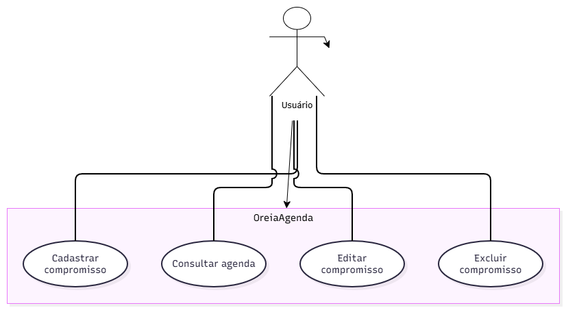

# 4.2.2 Modelagem de Casos de Uso

## Atores

O sistema interage com um papel principal que realiza o gerenciamento dos compromissos diários.

| Ator | Quem é | O que faz no sistema |
|---|---|---|
| Usuário | pessoa que utiliza a agenda para gerenciar sua rotina | cadastra, consulta, edita e exclui seus compromissos |

## Casos de uso

Os casos de uso abaixo representam os objetivos que o usuário alcança no sistema, baseados diretamente nos requisitos funcionais levantados.

| Caso de uso | Ator | Atende |
|---|---|---|
| Cadastrar compromisso | Usuário | RF01 |
| Consultar agenda | Usuário | RF02 |
| Editar compromisso | Usuário | RF03 |
| Excluir compromisso | Usuário | RF04 |

## Diagrama de casos de uso

**Figura 1 – Diagrama de casos de uso do OreiaAgenda**

Fonte: Autoria própria (2026).

A Figura 1 apresenta a fronteira do sistema OreiaAgenda com o ator Usuário posicionado do lado de fora. As quatro elipses internas correspondem aos casos de uso principais do sistema, conectados ao ator por associações simples e contínuas, sem pontas de seta.

## Especificação do caso de uso principal

O **Cadastrar compromisso** é a funcionalidade central do OreiaAgenda, pois é o motivo principal de o sistema existir: tirar a rotina da cabeça e registrar os compromissos.

| Campo | |
|---|---|
| Caso de uso | Cadastrar compromisso |
| Ator | Usuário |
| Pré-condição | O usuário está com o sistema aberto e possui as informações do compromisso (título, data e horário). |
| Pós-condição | O compromisso é salvo com sucesso e passa a figurar nas consultas da agenda. |

**Fluxo principal**

1. O usuário aciona a opção de cadastrar um novo compromisso informando os dados necessários.
2. O sistema valida os campos obrigatórios e a data informada.
3. O sistema confirma que o compromisso foi cadastrado com sucesso.

**Fluxo alternativo**

- **A1, no passo 2: o usuário deixou algum campo obrigatório em branco.** O sistema exibe um aviso informando qual campo falta preencher, o usuário completa a informação e o fluxo retorna ao passo 2.

**Fluxos de exceção**

- **E1, no passo 2: a data informada já passou ou é inválida.** O sistema rejeita o cadastro e avisa que não é possível agendar compromissos em datas passadas. O caso de uso termina sem realizar a pós-condição.

## Rastreabilidade com a 4.2.1

| Requisito | Caso de uso | Onde aparece |
|---|---|---|
| RF01 Cadastrar compromisso | Cadastrar compromisso | elipse e especificação |
| RF02 Consultar agenda | Consultar agenda | elipse |
| RF03 Editar compromisso | Editar compromisso | elipse |
| RF04 Excluir compromisso | Excluir compromisso | elipse |

**Todo requisito tem lugar.** Todos os requisitos funcionais levantados na 4.2.1 viraram elipses correspondentes no diagrama e na tabela de rastreabilidade, mantendo a consistência de nomes de ponta a ponta.
